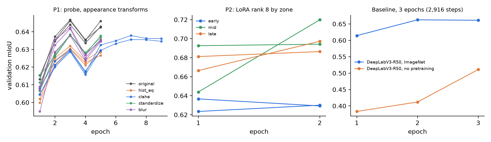

# Frozen DINOv3 features for Martian terrain segmentation (AI4Mars)

How do the features of a DINOv3 pretrained on web images extend to the Martian domain? We study a **frozen DINOv3 ViT-B/16** on
**AI4Mars** (Curiosity NavCam; four classes: soil, bedrock, sand, big rock) from three angles: whether the gap is one of image
**appearance** (P1), where in the network it pays to **adapt** (P2), and where the model makes **errors** and whether it knows (P3).
An earlier layer-wise study of the same backbone (probe, decoder, partial fine-tuning, controls) provides the context.

**In short.** A linear probe with 4.6 k trainable parameters on the frozen backbone matches, within the statistical margin, a DeepLabV3
trained end to end under the same compute budget, with about 8,600 times fewer trainable parameters. Neither changing how the images look nor
adapting early, middle or late blocks moves the score by more than about 0.01 mIoU. What limits it is the ambiguity of the labels and the rare
`big_rock` class, on which the model is confidently wrong.

> **Resumen (ES).** Una sonda lineal de 4,6 k parámetros sobre DINOv3 congelado iguala, dentro del margen estadístico, a un DeepLabV3
> entrenado de punta a punta con el mismo presupuesto de cómputo, con unas 8,600 veces menos parámetros entrenables. Ni cambiar la
> apariencia de las imágenes ni adaptar bloques tempranos, medios o tardíos con LoRA mueve el resultado más de ~0,01 mIoU. El techo lo
> ponen la ambigüedad de las etiquetas y la clase `big_rock`, donde el modelo está muy seguro y se equivoca. Todo es reproducible desde los
> resultados incluidos.

**Contents:** [Deliverables](#where-to-find-each-deliverable) · [Main findings](#main-findings-main-study) · [Earlier layer-wise study](#earlier-study-layer-wise-probes-decoder-and-fine-tuning) ·
[Paper, poster and abstract](#paper-poster-and-abstract) · [How results were produced](#how-the-results-were-produced) · [Repository layout](#repository-layout) · [Reproduce](#reproduce) ·
[Protocol](#protocol) · [Limitations](#limitations) · [Data, weights and licences](#data-weights-and-licences) · [References](#references)

## Where to find each deliverable

| What the course asks for | Where it is |
|---|---|
| Research question and contribution | [Paper](entregables/E3_trabajo_y_articulo/articulo/main.pdf), Introduction; summary at the top of this README |
| Phase A, architecture teardown | [`teardown_table.csv`](results/estudio_principal/teardown_table.csv), [`raw/a/teardown.json`](results/estudio_principal/raw/a/teardown.json); code in `notebooks/estudio_principal/A_datos_y_errores` |
| Phase B, controlled interventions with prior hypotheses | P1 (appearance) and P2 (LoRA by depth): [`P1_table.csv`](results/estudio_principal/P1_table.csv), [`P2_table.csv`](results/estudio_principal/P2_table.csv); rules in [`hipotesis_datos_completos.json`](notebooks/estudio_principal/hipotesis_datos_completos.json), registered before the runs |
| Phase C, stress and honesty | P3 (labels and calibration), the baseline comparison and the limitations: [Main findings](#main-findings-main-study), [Limitations](#limitations), [paper](entregables/E3_trabajo_y_articulo/articulo/main.pdf) |
| Baseline and state of the art | [`baseline_table.csv`](results/estudio_principal/baseline_table.csv); Related work in the [paper](entregables/E3_trabajo_y_articulo/articulo/main.pdf); earlier layer-wise study with published numbers [below](#earlier-study-layer-wise-probes-decoder-and-fine-tuning) |
| Several seeds and uncertainty | 3 seeds for probes, 2 for LoRA, paired block-bootstrap intervals in every table; raw per-run files in `results/estudio_principal/raw/` |
| Design log, with where AI was used | [`DESIGN_LOG.md`](DESIGN_LOG.md) |
| Limitations, bias and ethics | [Limitations](#limitations) here and the corresponding section of the [paper](entregables/E3_trabajo_y_articulo/articulo/main.pdf) |
| Reproducibility | [Reproduce](#reproduce), `requirements.txt`, fixed seeds, per-run raw results |
| E1, E2, E3 (proposal, poster and abstract, paper) | [`entregables/`](entregables/) |

## Main findings (main study)

The study uses all 15,564 training images, the same split and the same expert test sets (M1, M2, M3; 322 images each) throughout. Notebooks are in
[`notebooks/estudio_principal/`](notebooks/estudio_principal/) and results in [`results/estudio_principal/`](results/estudio_principal/). Decision rules for each hypothesis were written down before running
([`hipotesis_registradas.json`](notebooks/estudio_principal/hipotesis_registradas.json), 02/11/2026 01:54) and saved again for the full data, after a 2,000-image pilot was known and before any
full result was seen ([`hipotesis_datos_completos.json`](notebooks/estudio_principal/hipotesis_datos_completos.json)). The two files were renamed after the runs (they were first called `hypotheses_v2*.json`); their content is unchanged and the git history shows the original names and timestamps.

| Model (test mIoU, mean of seeds) | Trainable params | M1 | M2 | vs. probe (M1) |
|---|---|---|---|---|
| Linear probe on frozen DINOv3 (3 seeds) | 4.6 k | 0.674 | 0.723 | n/a |
| DeepLabV3 ResNet-50, ImageNet-pretrained, end to end (1 seed) | 39.6 M | 0.667 | 0.713 | −0.007 [−0.025, +0.008], inconclusive |
| DeepLabV3 ResNet-50, no pretraining (1 seed) | 39.6 M | 0.628 | 0.681 | −0.046 [−0.081, −0.016], real |

The comparison is budget-matched: both baselines train for 3 epochs (about 2,900 steps, 70 minutes each). The ImageNet run had stopped improving by then;
the run without pretraining was still rising, so its figure understates what longer training would give. Read the table as "the probe matches it", and
the gain as one of cost.

**P1, appearance.** Histogram equalisation, CLAHE and per-image standardisation leave the probe's mIoU where it was: CLAHE and standardisation are equivalent to the
original images on M1 (within ±0.01) and global equalisation is slightly lower (−0.006). Blurring away fine texture does not sink it either (−0.002 on M1), and the class
that loses most is soil, not sand as we predicted. The gap does not look photometric. M2 intervals are wider than ±0.01, so several comparisons cannot be decided.

**P2, where to adapt.** LoRA (rank 8, 221 k parameters) on blocks 1–2, 6–7 or 11–12 gains +0.005 to +0.007 over the probe on M1, and the zones do not differ
(late − early: −0.000 on M1, [−0.006, +0.015]). Adaptation adds little wherever it goes.

**P3, errors.** Where the experts agree, mIoU is 0.862; where only one labelled the pixel, 0.546 (difference +0.315 [+0.180, +0.413]), so part of the ceiling is
label ambiguity. Calibration is good overall (ECE 0.029), but on pixels predicted `big_rock` confidence exceeds accuracy by +0.674 [+0.435, +0.762], and 45 % of
the `big_rock` pixels are missed.

**Teardown.** Parameters and FLOPs per block in [`teardown_table.csv`](results/estudio_principal/teardown_table.csv); latency, peak memory and feature statistics in [`raw/a/teardown.json`](results/estudio_principal/raw/a/teardown.json). All 12 blocks cost the same.

The study tests three hypotheses, one per question. H1 (the gap is not photometric; registered parts HP1, HP1b) and H2 (late blocks help most; HP2) are inconclusive at this sample size, and H3 (the ceiling is set by the labels and the model is overconfident on `big_rock`; HP3a, HP3b) is supported. Per-part evidence is in
[`veredictos.csv`](results/estudio_principal/veredictos.csv). A difference is **real** when its paired block-bootstrap 95 % interval (blocks of 10 consecutive images) excludes 0 and
|Δ| ≥ 0.01, **equivalent** when the interval lies inside ±0.01, and inconclusive otherwise; Holm's correction is applied within each hypothesis.
Tables: [`P1_table.csv`](results/estudio_principal/P1_table.csv), [`P2_table.csv`](results/estudio_principal/P2_table.csv), [`baseline_table.csv`](results/estudio_principal/baseline_table.csv); figures in [`results/estudio_principal/figures/`](results/estudio_principal/figures/).

**Training curves.** Only validation mIoU per epoch was logged (no training loss): [`training_curves.png`](results/estudio_principal/figures/training_curves.png), made by [`src/make_training_curves.py`](src/make_training_curves.py). The probes peak around epoch 3 and early stopping ended most of them at epoch 5; the ImageNet baseline plateaus near 0.66 while the one without pretraining was still rising. On validation the LoRA zones separate (middle and late 0.69–0.72, early 0.62–0.64, below the probe), whereas on test the three zones are within 0.002 of one another. HP2 is decided on test, so its verdict does not change, but validation and test disagree on this point and we do not explain it.



The same study first ran with 2,000 training images ([`results/estudio_principal_piloto/`](results/estudio_principal_piloto/)) and led to the same conclusions. It is kept as an independent replicate.

## Earlier study: layer-wise probes, decoder and fine-tuning

The first run (stages A–E in `notebooks/ai4mars_dinov3_final.ipynb`) probed the backbone layer by layer, then added a decoder and partial fine-tuning, and compared against
DINOv2, a random-init ViT and published models. Test mIoU, mean of 3 seeds, 512 px, 15,564 training images (stage D: 2,000):

| Method (frozen backbone unless stated) | Trainable params | M1 | M2 | M3 |
|---|---|---|---|---|
| Linear probe, final layer | 4.6 k | 0.677 | 0.725 | 0.827 |
| Decoder (blocks 3, 6, 9, 12) | 3.5 M | 0.684 | 0.735 | 0.931 |
| Last 4 blocks fine-tuned (N = 4,000) | 28 M | 0.687 | 0.737 | 0.927 |
| DINOv2 ViT-B/14, linear probe (N = 2,000) | 4.6 k | 0.664 | 0.714 | 0.798 |
| DINOv2 ViT-B/14 at 448 px (same 32×32 token grid as DINOv3), probe (N = 2,000) | 4.6 k | 0.664 | 0.715 | 0.806 |
| DINOv3 architecture, random init, probe (N = 2,000) | 4.6 k | 0.264 | 0.272 | 0.272 |
| *Published: DeepLabV3+ R101 @512 px* | 58.8 M | 0.67 | 0.72 | 0.82 |
| *Published: SegFormer-B3 @1,024 px* | 47 M | 0.69 | 0.74 | 0.93 |
| *Published: UPerNet Swin-S @1,024 px* | 81.2 M | 0.70 | 0.74 | 0.94 |

Published rows come from Mohammad, Li & Gao (iSpaRo 2025, Table I): single runs on another split and with their own mIoU convention, so the comparison is indicative, not
like-for-like. Full table with 95 % intervals per class: [`results/final_run/table_main.csv`](results/final_run/table_main.csv).

- **Saturation on M1/M2.** Probe, decoder and fine-tuning end up within 0.012 mIoU; 250 labelled images give 99 % of the probe's M1 mIoU (0.671 against 0.675 at 4,000).
- **Pretraining matters.** A frozen random-init ViT reaches 0.264 on M1. This is a lower bound, not a from-scratch end-to-end control, so it does not separate pretraining from
  architecture. DINOv3 beats DINOv2 by +0.013 on M1 (95 % CI [+0.002, +0.025]) but not clearly on M2. Rerunning DINOv2 at 448 px to match the token grid does not shrink the gap
  (+0.014 on M1 [+0.003, +0.026]; +0.010 on M2 [−0.004, +0.025]); input pixels still differ (448 against 512).
- **No intermediate layer beats the last one.** The best intermediate by validation (block 10) is −0.010 on M1 (CI [−0.021, +0.001]).
- **M3 cannot rank models on `big_rock`.** Only 5 of its 322 images contain that class. Every model finds 96–99 % of those pixels and they differ in false positives
  (probe ~109 k px, decoder ~16 k px), which alone drives the M3 gap (0.83 against 0.93). Without `big_rock`, all models score 0.96–0.97 on M3.
- **Label borders.** Excluding a band of 8 px around label edges raises every head by about 0.025 mIoU on M1 (probe 0.677 → 0.702), consistent with, but not proof of, label noise at borders.

This run had its own hypotheses, written before it and kept in [`results/final_run/`](results/final_run/) ([`hypotheses_preregistered.json`](results/final_run/hypotheses_preregistered.json), [`hypothesis_verdicts.csv`](results/final_run/hypothesis_verdicts.csv)); they are superseded by the three of the main study above, which is the one the paper reports.

## Paper, poster and abstract

- All versions of the course deliverables E1, E2 and E3 are in [`entregables/`](entregables/) (index with dates and contents).
- Article (IEEE conference format, 5 pages; LaTeX source and PDF): [`main.pdf`](entregables/E3_trabajo_y_articulo/articulo/main.pdf), [`main.tex`](entregables/E3_trabajo_y_articulo/articulo/main.tex).
- Poster and 2-page abstract, final version (combining the layer-wise and the main study): [`entregables/E2_poster_waimlap/version_final/`](entregables/E2_poster_waimlap/version_final/); first version (layer-wise study): [`version_octubre/`](entregables/E2_poster_waimlap/version_octubre/).
- Executed analysis notebook as a web page: [`docs/Resultados_ejecutado.html`](docs/Resultados_ejecutado.html) (download and open in a browser).
- Design log (each decision, why, and where AI assistance was used): [`DESIGN_LOG.md`](DESIGN_LOG.md).

## How the results were produced

The long runs (A, B and D) were launched as asynchronous Kaggle kernels on 2 × T4 GPUs and executed from start to finish there, so the `.ipynb` files in this repository are the
**sources, saved without outputs**. What was produced is kept as evidence:

- the console log of each full-data run, in [`results/estudio_principal/logs/`](results/estudio_principal/logs/): teardown and P1 (A), LoRA middle and late (B), LoRA early (B), baseline (D);
- one JSON per run with its configuration, seed, best epoch and per-epoch validation mIoU, and one `.npz` with per-image confusion matrices, in [`results/estudio_principal/raw/`](results/estudio_principal/raw/);
- [`notebooks/estudio_principal/C_resultados.ipynb`](notebooks/estudio_principal/C_resultados.ipynb), which **was executed** and is stored with its outputs: it needs no GPU and rebuilds every table, figure and verdict from the raw files in a few seconds.

So any number in the paper can be traced to a raw file and re-derived without re-training. Re-training itself takes about 2 h 25 min (A), 1 h 45 min (B) and 80 min (D) on 2 × T4.

## Repository layout

```
notebooks/
  ai4mars_dinov3_final.ipynb   earlier study: stages A-E, resumable, 2 GPUs (source: .py)
  py_to_ipynb.py               regenerates any .ipynb from its .py: python notebooks/py_to_ipynb.py <file.py>
  estudio_principal/           main study (each notebook has a .py source and its .ipynb)
    A_datos_y_errores          teardown, P1 (image appearance), data for P3
    B_modelo                   P2 (LoRA by depth)
    C_resultados               analysis on CPU: tables, figures, verdicts (A4M_RUN=full | pilot)
    D_baseline                 DeepLabV3 ResNet-50 baseline trained end to end
    a4m_lib.py                 shared plumbing (data, token caches, training loop, metrics, result store)
    hipotesis_*.json        decision rules, written before running
src/
  make_figures.py              figures for the earlier study
results/
  estudio_principal/           main study with 15,564 images: tables, figures, raw/{a,b,d}
  estudio_principal_piloto/    same study with 2,000 images (independent replicate)
  final_run/                   output of the earlier study (see results/README.md)
  figures/                     figures built by src/make_figures.py
entregables/                   course deliverables: E1 proposal and teardown, E2 poster and abstract (October and final versions), E3 article
docs/                          code guide and the executed analysis notebook as HTML
DESIGN_LOG.md                  design log
```

Stages of the earlier notebook: **A** one linear probe per layer · **B** decoder head · **C** label efficiency and partial fine-tuning ·
**D** DINOv3 vs DINOv2 vs random init · **E** analysis (bootstrap intervals, paired tests, label-noise ceiling, `big_rock` by size, verdicts).
Every metric is stored as a per-image confusion matrix, so any number can be re-bootstrapped over images.

## Reproduce

**1. Analysis of the main study (CPU).** Regenerates `results/estudio_principal/` (or `results/estudio_principal_piloto/`) from the raw per-run files in `raw/`:

```bash
pip install -r requirements.txt
A4M_RUN=full  python notebooks/estudio_principal/C_resultados.py      # or A4M_RUN=pilot
```

**2. Re-run of the main study on Kaggle.** Notebooks A, B and D (sources without outputs; see above) import `a4m_lib.py` (attach `notebooks/estudio_principal/` as a dataset). Environment variables select the mode:
`A4M_FULL=1` (all 15,564 images; token caches go to disk), `A4M_ZONES=early,mid,late` (B), `A4M_SMOKE=1` (tiny offline self-test). Without `A4M_FULL`
they run the 2,000-image pilot. Measured on 2 × T4 including data loading: A ≈ 2 h 25 min, B ≈ 1 h 45 min, D ≈ 80 min (training budget set by `BUDGET_MIN`).

**3. Earlier study, analysis and figures from the released results (CPU only; no dataset or weights needed; about 12 s on a laptop CPU).**
It regenerates `table_main.csv` and `hypothesis_verdicts.csv` byte for byte.

```bash
pip install -r requirements.txt
cp -r results/final_run /tmp/a4m_repro        # stage E writes into its output folder; keep the committed copy intact
A4M_ONLY_E=1 A4M_OUT=/tmp/a4m_repro python notebooks/ai4mars_dinov3_final.py
python src/make_figures.py                    # rewrites results/figures/
```

**4. Earlier study, full re-run on Kaggle** (≈ 6.5 h wall-clock on 2 × T4, ≈ 12 GPU-hours).
Create a Kaggle notebook from `notebooks/ai4mars_dinov3_final.ipynb`, set the accelerator to 2 × T4 and attach:

- an AI4Mars copy with the `msl/ncam/{images/edr, labels/train, labels/test/masked-gold-min{1,2,3}-100agree}` layout;
- the DINOv3 ViT-B/16 weights (`facebook/dinov3-vitb16-pretrain-lvd1689m`), either as an attached model/dataset folder containing
  `config.json` and `model.safetensors` or through a Hugging Face token stored as the `HF_TOKEN` secret.

Results are cached per unit of work, so an interrupted run resumes where it stopped (attach the earlier output as an input). `A4M_SMOKE=1` runs a tiny offline self-test.
To run one stage on selected backbones, set e.g. `A4M_STAGES=D A4M_BACKBONES=dinov2_b14_448` (this is how the H3b extra run was launched: about 25 min on one T4).
Seeds are fixed (0, 1, 2) and each stage records its configuration next to its results.

## Protocol

- Split: training pool of 15,564 images, validation of 500 images held out by acquisition time, test = the three expert-labelled sets; training images that appear in a test set are removed (0 found).
- Images are resized bilinearly and labels with nearest neighbour; unlabelled pixels (255) are never counted. mIoU averages only the classes with non-empty union.
  The epoch, the layer and the learning rates are chosen on validation, never on test.
- Training augmentation (random crop 50–100 % and horizontal flip) is applied after resizing to 512 px; stages C and D of the earlier study train on cached tokens without augmentation.
- In the earlier study the layer-wise probes train 4 epochs and the decoder 12, so probe and decoder differ in more than capacity.

## Limitations

- **Scope.** One backbone size, one rover and camera, 322 test images per variant. The results say nothing about other planets, sensors or safety-critical use.
- **main-study experiments.** Validation and test disagree on the LoRA zones (see training curves). Early stopping cut most P1 probes at epoch 5, before the learning rate had decayed (0.674 against 0.677 in the earlier run), and the three seeds share batch order, so
  seed variance is understated. P2 uses 2 seeds, 2 epochs per run and a learning rate fixed from the pilot. The baseline has 1 seed and 3 epochs. Intervals are limited by the test-set size, so they are no narrower than in the pilot.
- **Comparisons.** Published numbers were not re-run under our protocol, and there is no end-to-end from-scratch control for the ViT. The H3b extra run was launched in a separate session with the same code and recipe as stage D.
- **Labels.** AI4Mars training labels are crowd-sourced and noisy. M3 holds `big_rock` in only 5 of 322 images, so it cannot rank models on that class.
- **Process.** The first pilot used 2,000 training images and was not flagged at once as different from the full training; this was corrected and the full-data runs are the ones reported (see the design log).

## Data, weights and licences

AI4Mars (Swan et al., CVPR Workshops 2021) is not included; get it from its original source and check its licence there (its mirrors do not all state the same one).
DINOv3 weights are not included and are subject to Meta's DINOv3 licence. The code in this repository was written with the help of an AI model (Claude).

## References

- O. Siméoni et al., "DINOv3," arXiv:2508.10104, 2025.
- R. M. Swan et al., "AI4MARS: A dataset for terrain-aware autonomous driving on Mars," CVPR Workshops, 2021.
- F. Mohammad, Y. Li, Y. Gao, "Transformers vs CNNs: Enhancing semantic segmentation for Martian terrain classification," iSpaRo, 2025.
- E. Goh, J. Chen, B. Wilson, "Mars terrain segmentation with less labels," arXiv:2202.00791, 2022. Closest prior work on few labels: contrastive pretraining of their own backbone, then few labels; reports pixel accuracy, not mIoU.
- P. Durai, G. Doran, "MANTLE: a framework for adaptive in-situ planetary perception using a modular uplink principle," arXiv:2608.28724, 2026.
- E. J. Hu et al., "LoRA: Low-rank adaptation of large language models," ICLR, 2022.
